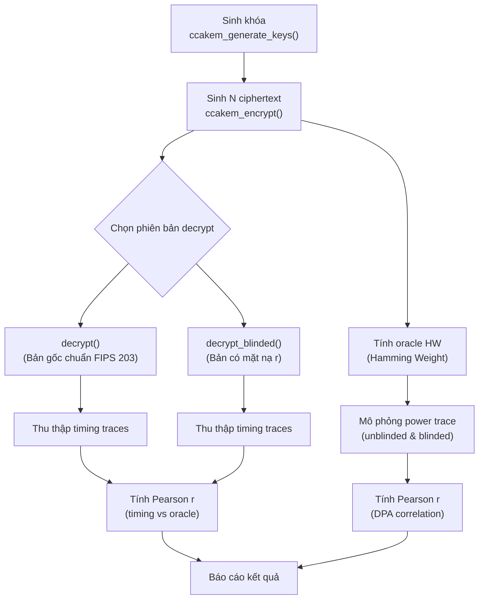

# CRYSTALS-Kyber — Triển khai và Đánh giá An toàn Kênh bên (KyberGuard)


-green)

---

## 1. Tổng quan dự án

Dự án triển khai thuật toán mã hóa hậu lượng tử **CRYSTALS-Kyber** (phiên bản **Kyber1024**) bằng ngôn ngữ Python, đồng thời nghiên cứu và đánh giá các biện pháp **bảo vệ chống tấn công kênh phụ** (Side-Channel Attack). Cụ thể, dự án bao gồm:

- **Triển khai đầy đủ** cơ chế đóng gói khóa IND-CCA2 (KEM) theo đặc tả NIST FIPS 203 (ML-KEM, tên chuẩn hóa của Kyber).
- **Đề xuất và triển khai kỹ thuật NTT Blinding** — kỹ thuật che giấu khóa bí mật trong miền NTT nhằm giảm rò rỉ năng lượng bậc nhất (DPA/CPA).
- **Mô phỏng tấn công kênh phụ** (phân tích định thời và DPA theo mô hình Hamming Weight) để đánh giá hiệu quả của biện pháp bảo vệ.
- **So sánh hiệu năng** giữa hai phiên bản: giải mã gốc (không bảo vệ) và giải mã NTT + Blinding.

> **Phạm vi và giới hạn:** DPA trong dự án là **mô phỏng theo mô hình Hamming Weight**, không phải đo năng lượng thật trên phần cứng. Blinding nhắm vào rò rỉ năng lượng; nó **không** làm mã Python trở thành constant-time. Kết quả timing được trình bày như một **kết quả đo thực nghiệm**, không phải bằng chứng blinding chống được tấn công định thời.

> **Nguồn gốc mã:** dự án được phát triển từ mã nguồn mở [PyryL/kyber](https://github.com/PyryL/kyber) (triển khai CRYSTALS-Kyber bằng Python của tác giả PyryL). Phần triển khai Kyber cơ bản (KeyGen, Encrypt, Decrypt, CCA-KEM, NTT, các tiện ích) có nguồn từ repo này; phần mở rộng của KyberGuard được liệt kê tại mục 9. Xem thêm thông tin giấy phép ở mục 9 và phần License.

---

## 2. Tổng quan bài toán

### 2.1. Bối cảnh

Khi hai bên muốn trao đổi thông tin an toàn qua mạng không bảo mật, họ cần mã hóa. Phương pháp phổ biến là sử dụng **Cơ chế Đóng gói Khóa (KEM)**: hai bên thỏa thuận một khóa chung thông qua mã hóa bất đối xứng, sau đó dùng khóa này để mã hóa đối xứng (ví dụ AES) cho dữ liệu thực tế.

Các thuật toán trao đổi khóa truyền thống (RSA, Diffie–Hellman, ECDH) đều dựa trên bài toán phân tích số nguyên hoặc logarit rời rạc — những bài toán mà **thuật toán Shor** trên máy tính lượng tử có thể giải trong thời gian đa thức. Do đó, NIST đã chuẩn hóa **CRYSTALS-Kyber** (ML-KEM) làm thuật toán KEM hậu lượng tử đầu tiên (FIPS 203, 2024).

### 2.2. Bài toán nền tảng — Module-LWE

Kyber dựa trên bài toán **Module Learning With Errors (M-LWE)** trên vành đa thức:

$$R_q = \mathbb{Z}_q[x] / (x^n + 1), \quad n = 256, \quad q = 3329$$

Cho ma trận $\mathbf{A} \in R_q^{k \times k}$, vector bí mật $\mathbf{s} \in R_q^k$ với hệ số nhỏ, và vector nhiễu $\mathbf{e}$ với hệ số nhỏ, bài toán yêu cầu tìm $\mathbf{s}$ từ:

$$\mathbf{t} = \mathbf{A} \cdot \mathbf{s} + \mathbf{e}$$

Bài toán này được cho là khó giải ngay cả với máy tính lượng tử, tạo nền tảng an toàn cho Kyber.

### 2.3. Vấn đề tấn công kênh phụ

Ngoài tấn công toán học, hệ mật còn có thể bị khai thác thông qua **kênh phụ vật lý** — thông tin rò rỉ từ thời gian thực thi, mức tiêu thụ năng lượng, hay bức xạ điện từ. Dự án nghiên cứu hai loại chính:

| Loại tấn công | Mô tả | Mô hình mô phỏng |
|---|---|---|
| **Phân tích định thời (Timing)** | Thời gian giải mã có thể phụ thuộc vào dữ liệu | Đo `time.perf_counter_ns()` qua $N$ lần decrypt |
| **DPA** (Differential Power Analysis) | Năng lượng tiêu thụ tương quan với dữ liệu trung gian | Mô hình Hamming Weight: $\text{power} \sim HW(\text{kết quả trung gian})$ |

---

## 3. Mô tả nội dung

Dự án triển khai đầy đủ pipeline mã hóa/giải mã Kyber1024 và kỹ thuật bảo vệ kênh phụ:

```
Alice                                    Bob
  │                                        │
  ├─ (sk, pk) = generate_keys()            │
  │                                        │
  ├────────── pk ─────────────────────────►│
  │                                        │
  │                        (c, K) = encrypt(pk)
  │                                        │
  │◄──────── c ────────────────────────────┤
  │                                        │
  ├─ K = decrypt(sk, c)                    │
  │                                        │
  │  K giống nhau ở hai phía               │
  │  => Dùng K làm khóa AES                │
  └────────────────────────────────────────┘
```

### Các tính năng chính

1. **Sinh khóa (KeyGen)**: Sinh ma trận $\mathbf{A}$ từ seed, vector bí mật $\mathbf{s}$ và nhiễu $\mathbf{e}$ qua phân phối CBD, tính $\mathbf{t} = \mathbf{A}\mathbf{s} + \mathbf{e}$.
2. **Mã hóa (Encrypt)**: Tạo bản mã $(u, v)$ với $u = \mathbf{A}^T \mathbf{r} + \mathbf{e}_1$ và $v = \mathbf{t}^T \mathbf{r} + e_2 + \lceil q/2 \rceil \cdot m$.
3. **Giải mã (Decrypt)**: Tính $m = v - \mathbf{s}^T \mathbf{u}$ rồi làm tròn để phục hồi thông điệp gốc.
4. **CCA-KEM**: Bọc CPAPKE bằng biến đổi Fujisaki–Okamoto để đạt an toàn IND-CCA2.
5. **NTT Blinding**: Che giấu $\mathbf{s}$ bằng vector ngẫu nhiên $\mathbf{r}$ trong miền NTT, tính toán trên $\mathbf{s}^* = \mathbf{s} + \mathbf{r}$ rồi khử $\mathbf{r}$ sau — khóa bí mật không xuất hiện đơn lẻ trong phép nhân.
6. **Mô phỏng tấn công**: Phân tích định thời và DPA với hệ số tương quan Pearson để đo lường hiệu quả bảo vệ.

---

## 4. Mô tả các module dự án

### 4.1. Cấu trúc thư mục

```
kyber/
├── kyber/                          # Package chính của hệ thống KyberGuard
│   ├── constants.py                # Tham số Kyber1024 theo FIPS 203 (q=3329, n=256, k=4)
│   ├── ccakem.py                   # IND-CCA2 KEM (Biến đổi Fujisaki–Okamoto)
│   ├── side_channel_poc.py         # Mô phỏng tấn công kênh bên (Timing & DPA)
│   ├── encryption/                 # CPAPKE: mã hóa/giải mã khóa công khai
│   │   ├── __init__.py
│   │   ├── keygen.py               # Sinh cặp khóa CPAPKE
│   │   ├── encrypt.py              # Mã hóa CPAPKE
│   │   ├── decrypt.py              # Giải mã chuẩn FIPS 203 (bản gốc, chưa có mặt nạ)
│   │   └── decrypt_blinded.py      # Giải mã cải tiến có mặt nạ r (bản bảo vệ kênh bên)
│   ├── entities/
│   │   └── polring.py              # Cấu trúc dữ liệu vành đa thức PolynomialRing
│   └── utils/                      # Các hàm toán học và tiện ích bổ trợ
│       ├── ntt.py                  # Biến đổi số học NTT (Cooley-Tukey, base-mul)
│       ├── byte_conversion.py      # Chuyển đổi byte ↔ integer ↔ bit array
│       ├── cbd.py                  # Centered Binomial Distribution sampling
│       ├── compression.py          # Nén/giải nén hệ số đa thức modulo q
│       ├── encoding.py             # Mã hóa/giải mã đa thức ↔ byte array
│       ├── parse.py                # Rejection sampling từ XOF sang đa thức
│       ├── pseudo_random.py        # Các hàm băm SHA-3 (H, G, KDF, XOF, PRF)
│       └── round.py                # Hàm làm tròn chuẩn (half-up rounding)
├── tests/                          # Unit tests kiểm thử tính đúng đắn (pytest)
├── perf_tests/                     # Benchmark hiệu năng KEM và tích hợp AES-GCM
├── analysis/                       # Script phân tích so sánh Kyber vs AES
├── docs/                           # Tài liệu thiết kế (requirements, implementation, tests, usage)
├── images/                         # Đồ thị phân tán (scatter plots) và hình ảnh báo cáo
├── cli.py                          # Giao diện dòng lệnh (CLI keygen, encrypt, decrypt)
├── main.py                         # Điểm khởi chạy demo KEM cơ bản
├── demo_comparison.py              # Benchmark & so sánh bản gốc vs bản có mặt nạ r
├── test_dpa_quick.py               # Script kiểm tra nhanh độ giảm tương quan DPA
├── export_figures.py               # Xuất biểu đồ phân giải cao cho báo cáo LaTeX
├── tasks.py                        # Task runner tự động hóa (invoke: test, lint, perf)
├── pyproject.toml                  # Cấu hình dự án và dependencies qua Poetry
└── poetry.lock                     # Khóa phiên bản các gói phụ thuộc
```

### 4.2. Chi tiết các module

#### `kyber/constants.py` — Tham số Kyber1024

| Tham số | Giá trị | Ý nghĩa |
|---------|---------|---------|
| `n` | 256 | Bậc đa thức (kích thước plaintext theo bit) |
| `q` | 3329 | Modulus của vành đa thức $R_q$ |
| `k` | 4 | Chiều ma trận (Kyber1024 — mức bảo mật cao nhất) |
| `η₁` | 2 | Tham số nhiễu cho khóa bí mật và vector $\mathbf{r}$ |
| `η₂` | 2 | Tham số nhiễu cho $\mathbf{e}_1, e_2$ |
| `dᵤ` | 11 | Bit nén cho $\mathbf{u}$ (trong bản mã) |
| `dᵥ` | 5 | Bit nén cho $v$ (trong bản mã) |

> **Mức bảo mật**: Kyber1024 đạt mức an toàn NIST Level 5 (tương đương AES-256 về độ khó tìm khóa).

#### `kyber/encryption/` — CPAPKE (Mã hóa/Giải mã lõi)

- **`keygen.py`**: Sinh cặp khóa $(sk, pk)$.
  - Sinh seed ngẫu nhiên 32 bytes → tách $(\rho, \sigma)$ qua SHA-3 `G`.
  - Tạo ma trận $\mathbf{A} \in R_q^{k \times k}$ từ $\rho$ qua hàm `parse(XOF(...))`.
  - Sinh $\mathbf{s}, \mathbf{e}$ qua phân phối CBD từ $\sigma$.
  - Tính $\mathbf{t} = \mathbf{A}\mathbf{s} + \mathbf{e}$.

- **`encrypt.py`**: Mã hóa thông điệp 32 bytes thành bản mã.
  - Tái tạo $\mathbf{A}$ từ $\rho$ trong khóa công khai.
  - Sinh vector ngẫu nhiên $\mathbf{r}, \mathbf{e}_1, e_2$ qua CBD.
  - Tính $\mathbf{u} = \mathbf{A}^T\mathbf{r} + \mathbf{e}_1$ và $v = \mathbf{t}^T\mathbf{r} + e_2 + \text{Decompress}(m)$.
  - Nén và mã hóa thành byte array.

- **`decrypt.py`**: **Giải mã bản gốc (Baseline)** theo chuẩn FIPS 203 (chưa che mặt nạ).
  - Chuyển $\mathbf{s}, \mathbf{u}$ sang miền NTT, tính tích vô hướng $\hat{\mathbf{s}}^T \hat{\mathbf{u}}$ rồi phục hồi bản rõ.

- **`decrypt_blinded.py`**: **Giải mã cải tiến có mặt nạ $\mathbf{r}$** (đóng góp chính).
  - Che giấu khóa bí mật: $\hat{\mathbf{s}}^* = \hat{\mathbf{s}} + \hat{\mathbf{r}}$ với $\hat{\mathbf{r}}$ sinh ngẫu nhiên trực tiếp bằng CSPRNG.
  - Tính toán phân tách: $\hat{\mathbf{s}}^{*T}\hat{\mathbf{u}} - \hat{\mathbf{r}}^T\hat{\mathbf{u}} = \hat{\mathbf{s}}^T\hat{\mathbf{u}}$.
  - Xóa các biến trung gian sau khi dùng (zeroization theo nỗ lực tốt nhất; Python không đảm bảo xóa hoàn toàn bộ nhớ do cơ chế quản lý đối tượng).

#### `kyber/ccakem.py` — IND-CCA2 KEM

Bọc CPAPKE bằng biến đổi Fujisaki–Okamoto:
- `ccakem_generate_keys()`: Sinh khóa KEM (bao gồm $sk + pk + H(pk) + z$).
- `ccakem_encrypt(pk)`: Tạo shared secret 32 bytes + bản mã.
- `ccakem_decrypt(c, sk)`: Giải mã bản mã, kiểm tra tính hợp lệ để chống tấn công CCA.

#### `kyber/utils/ntt.py` — Number Theoretic Transform

Triển khai NTT chuẩn Kyber với $\zeta = 17$ (căn nguyên thủy bậc 256 mod $q$):
- `ntt()`: Forward NTT — Cooley-Tukey butterfly, $O(n \log n)$.
- `intt()`: Inverse NTT — Gentleman-Sande butterfly, $O(n \log n)$.
- `mul_ntt()`: Nhân trong miền NTT — 128 base-mul, $O(n)$.
- `dot_product_ntt()`: Tích vô hướng vector NTT — $O(k \cdot n)$.
- `add_ntt()`, `sub_ntt()`: Cộng/trừ hệ số theo vị trí mod $q$.

#### `kyber/entities/polring.py` — Vành đa thức

Lớp `PolynomialRing` đại diện cho phần tử trong $R_q$, hỗ trợ:
- Phép cộng, trừ, nhân đa thức (với reduction modulo $x^{256} + 1$).
- So sánh bằng.
- Kiểm tra giới hạn hệ số.

#### `kyber/utils/` — Tiện ích

| Module | Chức năng |
|--------|-----------|
| `pseudo_random.py` | Các hàm SHA-3: `H` (SHA3-256), `G` (SHA3-512), `KDF` (SHAKE-256), `XOF` (SHAKE-128), `PRF` (SHAKE-256) |
| `cbd.py` | Centered Binomial Distribution — sinh đa thức có hệ số nhỏ từ byte array |
| `compression.py` | Nén hệ số từ mod $q$ xuống $d$ bit và giải nén ngược lại |
| `encoding.py` | Mã hóa/giải mã `PolynomialRing` ↔ byte array |
| `parse.py` | Parse byte stream (XOF output) thành `PolynomialRing` |
| `byte_conversion.py` | Chuyển đổi integer ↔ bytes ↔ bit array |
| `round.py` | Hàm làm tròn chuẩn (ties rounded up, không away-from-zero) |

#### `kyber/side_channel_poc.py` — Mô phỏng tấn công kênh phụ

1. **Timing**: Đo thời gian decrypt $N$ lần, tính hệ số biến thiên (CV) và Pearson $r$ giữa timing và oracle.
2. **DPA**: Nhắm một cặp hệ số cụ thể trong base-mul, so sánh oracle $HW(s \cdot u)$ với power trace mô phỏng.
3. **Verify Correctness**: Kiểm chứng `decrypt() == decrypt_blinded()` trên nhiều cặp khóa độc lập.

---

## 5. Cách triển khai dự án

### 5.1. Yêu cầu hệ thống

| Thành phần | Yêu cầu |
|---|---|
| **Hệ điều hành (khuyến nghị)** | **Ubuntu 24.04 LTS** trên **WSL2** (Windows 10/11 64-bit) |
| **Python** | CPython **3.12.3** (bản mặc định của Ubuntu 24.04; đáp ứng ràng buộc `>=3.11,<3.13`) |
| **Trình quản lý gói** | [Poetry](https://python-poetry.org/) `>=1.5.0` |
| **Phần cứng thử nghiệm** | 11th Gen Intel Core i5-1135G7 @ 2.40GHz (8 luồng xử lý), 7.6 GiB RAM cấp phát cho WSL2 (16 GB máy vật lý) |

> **Vì sao Ubuntu 24.04?** Đây là bản LTS có sẵn Python 3.12 trong kho `apt` mặc định, khớp với ràng buộc phiên bản của dự án. Ubuntu 22.04 chỉ có Python 3.10 mặc định, còn các bản Ubuntu mới hơn (25.10, 26.04) mặc định dùng Python 3.13 trở lên, nằm ngoài phạm vi hỗ trợ của dự án.
>
> **Lưu ý:** Chạy trực tiếp trên Windows vẫn được cho phần test chức năng, nhưng `invoke` không chạy được do thiếu module `pty` (xem mục 5.4). Đối với benchmark và phân tích kênh phụ, hãy dùng WSL2 Ubuntu 24.04.

### 5.2. Cài đặt môi trường

#### Bước 1: Cài WSL2 và Ubuntu 24.04 (PowerShell, chạy bằng quyền Administrator)

```powershell
wsl --install -d Ubuntu-24.04
wsl --set-default-version 2
```

Khởi động lại máy nếu được yêu cầu, sau đó mở **Ubuntu 24.04** từ Start Menu để tạo username/password. Nếu cần kiểm tra danh sách bản có sẵn: `wsl --list --online`.

#### Bước 2: Kiểm tra phiên bản trong Ubuntu

```bash
lsb_release -a          # Release phải là 24.04
python3 --version       # phải là Python 3.12.3
```

Nếu `Release` không phải 24.04, hãy gỡ distro đó (`wsl --unregister <tên-distro>`, lệnh này xóa toàn bộ dữ liệu trong distro) rồi cài lại bằng lệnh ở Bước 1.

#### Bước 3: Cài công cụ nền và Poetry

```bash
sudo apt update && sudo apt upgrade -y
sudo apt install -y python3 python3-venv python3-pip python3-dev pipx git curl build-essential
pipx ensurepath
pipx install poetry
```

Mở lại terminal, rồi kiểm tra:

```bash
poetry --version
```

#### Bước 4: Đưa dự án vào hệ thống tệp Linux

> **Quan trọng:** không chạy dự án trực tiếp từ ổ Windows (`/mnt/d/...`). Truy cập tệp qua `/mnt` chậm hơn đáng kể và làm sai lệch số liệu timing. Hãy sao chép dự án vào thư mục home của Linux.

```bash
cp -r "/mnt/d/Luan Van Nghien Cuu/Lattice_Based Cryptography_Kyber/kyber" ~/kyber
cd ~/kyber
```

#### Bước 5: Tạo môi trường ảo và cài phụ thuộc

```bash
poetry env use python3.12
poetry install
poetry run python --version     # phải ra Python 3.12.3
```

Có thể mở thư mục bằng VS Code qua extension **WSL**: chạy `code .` trong `~/kyber`.

#### Cài đặt trực tiếp trên Windows (chỉ để chạy test, không dùng cho benchmark)

```powershell
cd "d:\Luan Van Nghien Cuu\Lattice_Based Cryptography_Kyber\kyber"
poetry install
```

**Danh sách thư viện phụ thuộc** (phiên bản cụ thể theo `poetry.lock`):

| Thư viện | Phiên bản | Vai trò |
|----------|-----------|---------|
| `numpy` | 1.26.1 | Thao tác mảng hệ số đa thức |
| `pycryptodome` | 3.19.0 | Hàm băm SHA-3 chuẩn FIPS 202 (SHA3-256, SHA3-512, SHAKE-128, SHAKE-256) |
| `matplotlib` | 3.8.2 | Xuất biểu đồ phân tán (scatter plots) |
| `pytest` | 7.4.3 | Framework kiểm thử đơn vị |
| `invoke` | 2.2.0 | Task runner (test, benchmark, lint) |
| `secrets` | (built-in) | CSPRNG của hệ điều hành, dùng tạo mặt nạ $\mathbf{r}$ |

### 5.3. Sử dụng cơ bản

#### Qua Python

```python
from kyber.ccakem import ccakem_generate_keys, ccakem_encrypt, ccakem_decrypt

# Sinh khóa
private_key, public_key = ccakem_generate_keys()

# Mã hóa (phía gửi)
ciphertext, shared_secret = ccakem_encrypt(public_key)

# Giải mã (phía nhận)
shared_secret2 = ccakem_decrypt(ciphertext, private_key)

assert shared_secret == shared_secret2  # Khóa chung giống nhau
```

#### Qua CLI

Xem tùy chọn chính xác của phiên bản hiện tại trước khi dùng:

```bash
poetry run python cli.py --help
```

Ví dụ quy trình đầy đủ (dùng tên tệp đầu ra khác tệp đầu vào để có thể đối chiếu):

```bash
# Sinh khóa
poetry run python cli.py keygen private.txt
poetry run python cli.py pubkey --output public.txt private.txt

# Tạo bí mật cần đóng gói (nếu CLI yêu cầu tệp đầu vào)
echo -n "bi-mat-thu-nghiem" > secret.txt

# Mã hóa
poetry run python cli.py encrypt --key public.txt --secret secret.txt --cipher cipher.txt

# Giải mã (ghi ra tệp khác để không đè lên secret.txt)
poetry run python cli.py decrypt --key private.txt --output secret_out.txt cipher.txt

# Đối chiếu kết quả
diff secret.txt secret_out.txt && echo "OK: giai ma khop voi ban goc"
```

> Nếu `--help` cho thấy tên tùy chọn khác với ví dụ trên, hãy ưu tiên theo `--help`.

### 5.4. Chạy kiểm thử tự động

Trên **WSL Ubuntu 24.04** (khuyến nghị):

```bash
# Chạy toàn bộ unit tests với chi tiết từng testcase
poetry run pytest -v

# Hoặc qua task runner invoke
poetry run invoke test

# Đo độ bao phủ mã nguồn
poetry run invoke coverage-report
```

Trên **Windows (PowerShell)**, `invoke` báo lỗi `You indicated pty=True, but your platform doesn't support the 'pty' module!`. Hãy chạy trực tiếp:

```powershell
poetry run pytest -v
poetry run coverage run --branch -m pytest tests
poetry run coverage report -m
poetry run coverage html
```

Hoặc sửa `tasks.py` để tự tắt `pty` trên Windows:

```python
import sys
from invoke import task

USE_PTY = sys.platform != "win32"

@task
def test(ctx):
    ctx.run("pytest tests", pty=USE_PTY)
```

Để xác nhận số lượng test hiện có: `poetry run pytest --collect-only -q`.

### 5.5. Chạy thực nghiệm đánh giá an toàn kênh bên

Chạy trong `~/kyber` trên WSL Ubuntu 24.04:

```bash
# 1. So sánh đầy đủ: verify tính đúng đắn + benchmark hiệu năng + mô phỏng tấn công
poetry run python demo_comparison.py

# 2. Chế độ kiểm tra nhanh (nếu script hỗ trợ; xác nhận bằng --help)
poetry run python demo_comparison.py --quick

# 3. Kiểm tra nhanh tương quan DPA (mô hình Hamming Weight)
poetry run python test_dpa_quick.py

# 4. Xuất biểu đồ phân giải cao cho báo cáo LaTeX
poetry run python export_figures.py
```

> **Chỉ áp dụng khi chạy trên Windows PowerShell:** nếu gặp lỗi mã hóa ký tự Unicode, thêm cờ `-X utf8`, ví dụ `poetry run python -X utf8 demo_comparison.py`. Trên WSL/Ubuntu không cần cờ này.

**Khuyến nghị để số đo ổn định:** đóng các ứng dụng nặng trên Windows, cắm sạc nguồn, chạy mỗi cấu hình nhiều lần và báo cáo trung bình kèm độ lệch chuẩn.

---

## 6. Thiết lập thực nghiệm

### 6.1. Cấu hình môi trường thực nghiệm

| Thành phần | Thông số |
|---|---|
| **Hệ điều hành** | **Ubuntu 24.04.5 LTS (x86_64) trên WSL2** (Kernel: `6.18.58.1-microsoft-standard-WSL2`, host: Windows 11) |
| **CPU** | 11th Gen Intel(R) Core(TM) i5-1135G7 @ 2.40GHz (8 luồng xử lý) |
| **RAM** | 7.6 GiB (cấp phát cho WSL2) / 16 GB RAM vật lý |
| **Python Runtime** | CPython 3.12.3 64-bit (quản lý bởi Poetry, yêu cầu `>=3.11,<3.13`) |
| **Vị trí mã nguồn khi đo** | `~/kyber` (hệ tệp ext4 của WSL, không dùng `/mnt/d`) |
| **Tiêu chuẩn áp dụng** | NIST FIPS 203 (ML-KEM-1024), sử dụng biến đổi NTT trong vành $R_q$ |

> Hãy cập nhật các thông số phần cứng (CPU, RAM) bằng đúng số liệu máy bạn dùng khi đo. Có thể lấy nhanh bằng `lscpu` và `free -h` trong WSL.

### 6.2. Compiler và Runtime

| Thành phần | Chi tiết |
|---|---|
| **Ngôn ngữ** | Python 3.12.3 (interpreted, CPython) |
| **Thư viện mã hóa** | PyCryptodome 3.19.0 — SHA-3 |
| **Thư viện toán** | NumPy 1.26.1 |
| **NTT** | Triển khai thuần Python, giúp quan sát rõ hành vi kênh phụ (không bị tối ưu hóa che lấp) |
| **Môi trường đo** | WSL2 (Linux POSIX) |

> **Về độ ổn định khi đo:** WSL2 chạy trên máy ảo nhẹ nên vẫn có jitter lập lịch. Môi trường Linux thường cho phương sai thấp hơn khi đo thời gian vi mô so với chạy trực tiếp trên Windows, nhưng đây là nhận định cần được kiểm chứng. Nên so sánh hệ số biến thiên (CV) giữa hai môi trường trên cùng máy nếu muốn khẳng định trong luận văn.

### 6.3. Cách đo hiệu năng

#### Đo thời gian (Timing Benchmark)

```python
# Mỗi ciphertext được decrypt 3 lần, lấy trung vị (median)
# để giảm nhiễu do scheduler OS, garbage collection, v.v.
for ct in ciphertexts:
    times = []
    for _ in range(3):
        t0 = time.perf_counter_ns()       # Độ phân giải nanosecond
        decrypt(sk, ct)
        elapsed = time.perf_counter_ns() - t0
        times.append(elapsed / 1_000)     # Chuyển sang microsecond (µs)
    result = statistics.median(times)
```

**Các chỉ số đo:**

| Chỉ số | Công thức | Ý nghĩa |
|--------|-----------|---------|
| Mean | $\bar{t} = \frac{1}{N}\sum t_i$ | Thời gian trung bình |
| StdDev | $\sigma = \sqrt{\frac{1}{N-1}\sum(t_i - \bar{t})^2}$ | Độ lệch chuẩn |
| CV | $CV = \frac{\sigma}{\bar{t}} \times 100\%$ | Hệ số biến thiên (mức độ dao động thời gian) |
| Overhead | $\frac{\bar{t}_{\text{blind}} - \bar{t}_{\text{ntt}}}{\bar{t}_{\text{ntt}}} \times 100\%$ | Chi phí thêm của blinding |

#### Đo tương quan kênh phụ (Side-Channel Correlation)

```python
# Hệ số tương quan Pearson r ∈ [-1, 1]
# |r| lớn  => dữ liệu trung gian rò rỉ qua kênh phụ
# |r| nhỏ  => rò rỉ bị che giấu
r = pearson_correlation(oracle_power, measured_trace)
```

### 6.4. Tham số thực nghiệm

| Tham số | Giá trị mặc định | Mô tả |
|---------|-------------------|-------|
| `num_samples` (timing) | 80 | Số ciphertext dùng trong phân tích định thời |
| `num_trials` (DPA) | 120 | Số lần decrypt cho DPA |
| `noise_std` | 1.5 (hoặc 2% giá trị oracle) | Nhiễu đo lường mô phỏng |
| Repetitions/sample | 3 | Số lần lặp mỗi phép đo (lấy median) |
| `_POL_TARGET` | 0 | Polynomial mục tiêu trong DPA |
| `_PAIR_TARGET` | 0 | Cặp hệ số mục tiêu trong base-mul |

### 6.5. Biến thể Kyber được thực nghiệm

| Biến thể | $k$ | $\eta_1$ | $\eta_2$ | $d_u$ | $d_v$ | Mức NIST |
|----------|-----|----------|----------|-------|-------|----------|
| **Kyber1024** (dự án này) | 4 | 2 | 2 | 11 | 5 | Level 5 |

---

## 7. Môi trường và công cụ triển khai đánh giá an toàn

### 7.1. Kiến trúc đánh giá



### 7.2. Công cụ đo lường

| Công cụ | Mục đích | Chi tiết |
|---------|----------|----------|
| `time.perf_counter_ns()` | Đo thời gian thực thi | Độ phân giải nanosecond, không bị ảnh hưởng bởi điều chỉnh đồng hồ hệ thống |
| `statistics.median()` | Lọc nhiễu timing | Lấy trung vị từ 3 lần chạy mỗi mẫu |
| `statistics.stdev()` | Đo biến động | Độ lệch chuẩn của phân phối timing |
| `pearson_r()` (tự triển khai) | Đo tương quan | Hệ số Pearson giữa oracle và trace |
| `secrets.token_bytes()` | CSPRNG | Sinh số ngẫu nhiên bảo mật (entropy của OS) |

### 7.3. Mô hình tấn công

#### Phân tích định thời (Timing)

- **Giả thuyết**: Thời gian decrypt có thể phụ thuộc vào giá trị ciphertext/khóa.
- **Phương pháp**: Decrypt $N$ ciphertext khác nhau, đo timing, tính Pearson $r$ giữa timing và oracle HW.
- **Cách diễn giải kết quả**: đây là phép đo thực nghiệm trên cài đặt Python. Blinding **không** được thiết kế để làm thời gian thực thi độc lập với dữ liệu, nên $|r|$ của timing ở bản có mặt nạ chỉ phản ánh kết quả đo được, không nên dùng làm bằng chứng chống tấn công định thời.

#### DPA — Differential Power Analysis (mô phỏng)

- **Mô hình**: Hamming Weight (HW) — năng lượng tiêu thụ tỷ lệ với số bit 1 của kết quả phép tính.
- **Mục tiêu**: Một cặp hệ số cụ thể trong phép base-mul:

$$\text{oracle} = HW\bigl(s[0] \cdot u[0] + s[1] \cdot u[1] \cdot \zeta \bmod q\bigr)$$

- **Vì sao chỉ nhắm một cặp**: Nếu cộng tất cả 512 phép nhân, Luật Số Lớn làm triệt tiêu phương sai nên $r \approx 0$ cho cả hai phiên bản. DPA thực tế nhắm từng byte/bit trung gian.
- **Trace mô phỏng**:
  - Bản gốc: $\text{trace} = \text{oracle} + \mathcal{N}(0, \sigma)$
  - Bản có mặt nạ: $\text{trace} = HW\bigl((s + r_{\text{random}}) \cdot u\bigr)$

> **Giới hạn quan trọng:** trace của bản có mặt nạ được sinh bằng chính mô hình HW trên $(s + r)\cdot u$, nên việc tương quan gần 0 phần nào là hệ quả của cách xây mô hình. Kết quả này chứng minh tính chất lý thuyết của che mặt nạ bậc nhất, **không** thay thế cho đo năng lượng thật trên phần cứng. Blinding bậc nhất cũng không chống được các tấn công DPA bậc cao.

### 7.4. Kỹ thuật bảo vệ: NTT Domain Blinding

```
Phép tính gốc (dễ bị tấn công):
    m = INTT( s_hat ⊙ u_hat )        ← s_hat xuất hiện trực tiếp

Phép tính có blinding (được bảo vệ):
    r_hat  ← random (sinh trực tiếp trong miền NTT)
    s*_hat = s_hat + r_hat            ← s_hat bị che giấu
    result = INTT( s*_hat ⊙ u_hat  -  r_hat ⊙ u_hat )
           = INTT( s_hat ⊙ u_hat )   ← kết quả chính xác
```

| Tiêu chí | Bản gốc (chưa bảo vệ) | Bản có mặt nạ r |
|----------|------------------------:|-------------------------:|
| Khóa bí mật $\mathbf{s}$ | Xuất hiện trực tiếp trong phép nhân | Được che: $\mathbf{s} + \mathbf{r}$ |
| Rò rỉ năng lượng bậc nhất (DPA/CPA) | Có (theo mô hình) | Giảm đáng kể (theo mô hình) |
| Chống DPA bậc cao | Không | Không |
| Chống phân tích định thời | Không | Không được thiết kế cho mục đích này |
| Overhead thời gian | Baseline | Xem kết quả đo của `demo_comparison.py` (mục tiêu < 20%) |
| Tính đúng đắn | Chuẩn FIPS 203 | Kết quả giống hệt bản gốc |

### 7.5. Tiêu chí đánh giá

| Tiêu chí | Ngưỡng chấp nhận | Phương pháp đo |
|----------|-------------------|----------------|
| **Tính đúng đắn** | `decrypt(sk, c) == decrypt_blinded(sk, c)` với mọi test case | Verify trên nhiều cặp khóa |
| **DPA correlation (gốc)** | $\|r\| > 0.5$ (chứng tỏ rò rỉ trong mô hình) | Pearson $r$ trên mẫu đo |
| **DPA correlation (mặt nạ)** | $\|r\| < 0.1$ | Pearson $r$ trên mẫu đo |
| **Overhead** | $< 20\%$ | So sánh mean timing bản gốc và bản có mặt nạ |
| **Reduction** | $> 90\%$ giảm tương quan DPA | $\bigl(1 - \frac{\|r_{\text{blind}}\|}{\|r_{\text{orig}}\|}\bigr) \times 100\%$ |

### 7.6. Hệ thống CI/CD

Nếu dùng GitHub Actions để chạy test trên mỗi commit, cấu hình ví dụ:

```yaml
# .github/workflows/main.yml
- Chạy trên: ubuntu-24.04
- Python: 3.12
- Bước: install → pytest → coverage
```

---

## 8. Tài liệu tham khảo

1. Avanzi, R. et al.: *CRYSTALS-Kyber Algorithm Specifications and Supporting Documentation* (v3.02, 2021). [PDF](https://pq-crystals.org/kyber/data/kyber-specification-round3-20210804.pdf)
2. NIST FIPS 203: *Module-Lattice-Based Key-Encapsulation Mechanism Standard* (ML-KEM, 2024).
3. NIST: *NIST Announces First Four Quantum-Resistant Cryptographic Algorithms* (2022). [Link](https://www.nist.gov/news-events/news/2022/07/nist-announces-first-four-quantum-resistant-cryptographic-algorithms)
4. Cryptopedia: *Kyber – How does it work?* [Link](https://cryptopedia.dev/posts/kyber/)
5. Wikipedia: *Key Encapsulation Mechanism*. [Link](https://en.wikipedia.org/wiki/Key_encapsulation_mechanism)
6. PyryL: *kyber* — triển khai CRYSTALS-Kyber bằng Python (mã nguồn gốc của dự án này). [GitHub](https://github.com/PyryL/kyber)

---

## 9. Ghi nhận nguồn gốc và đóng góp

### 9.1. Mã nguồn gốc

KyberGuard là bản **phát triển (fork/sửa đổi)** từ repo [PyryL/kyber](https://github.com/PyryL/kyber). Xin ghi nhận công của tác giả gốc đã xây dựng nền tảng triển khai Kyber bằng Python, bao gồm bộ khung CPAPKE, CCA-KEM, NTT và các hàm tiện ích, cùng bộ unit test, CLI và cấu hình CI.

### 9.2. Phần bổ sung và sửa đổi của KyberGuard

> Danh sách dưới đây dựa trên cấu trúc thư mục hiện tại. Hãy đối chiếu với lịch sử commit (`git log`, `git diff <commit-gốc>`) và chỉnh lại cho đúng thực tế trước khi nộp.

| Thành phần | Nội dung |
|---|---|
| `kyber/encryption/decrypt_blinded.py` | Giải mã có mặt nạ $\mathbf{r}$ trong miền NTT (đóng góp chính) |
| `kyber/side_channel_poc.py` | Mô phỏng phân tích định thời và DPA theo mô hình Hamming Weight |
| `demo_comparison.py` | Kiểm tra tính đúng đắn, benchmark và so sánh bản gốc với bản có mặt nạ |
| `test_dpa_quick.py` | Kiểm tra nhanh mức giảm tương quan DPA |
| `export_figures.py` | Xuất biểu đồ cho báo cáo |
| Tài liệu và cấu hình | README tiếng Việt, hướng dẫn chạy trên WSL2 Ubuntu 24.04, điều chỉnh lệnh cho Windows |

Các phần còn lại (ví dụ `ccakem.py`, `encryption/keygen.py`, `encrypt.py`, `decrypt.py`, `utils/`, `entities/`) giữ nguyên hoặc chỉ sửa nhỏ so với mã gốc. Nếu bạn có sửa đổi đáng kể ở các file này, hãy bổ sung vào bảng trên.

### 9.3. Cách kiểm tra phần khác biệt so với mã gốc

```bash
git remote add upstream https://github.com/PyryL/kyber.git
git fetch upstream
git diff upstream/main --stat
```

Lệnh này liệt kê chính xác các file đã thêm hoặc sửa so với repo gốc, có thể dùng để lập bảng ở mục 9.2 và trình bày trong luận văn.

---

## Tài liệu bổ sung trong dự án

| Tài liệu | Mô tả |
|-----------|-------|
| [docs/requirements.md](docs/requirements.md) | Đặc tả yêu cầu |
| [docs/implementation.md](docs/implementation.md) | Chi tiết triển khai |
| [docs/tests.md](docs/tests.md) | Báo cáo kiểm thử |
| [docs/usage.md](docs/usage.md) | Hướng dẫn sử dụng |

---

## License

Dự án phục vụ mục đích nghiên cứu và học thuật.

Mã nguồn gốc thuộc về tác giả PyryL và được phân phối theo giấy phép ghi trong repo gốc. Hãy mở file `LICENSE` của [PyryL/kyber](https://github.com/PyryL/kyber), giữ nguyên thông báo bản quyền và giấy phép đó trong repo của bạn, và ghi rõ loại giấy phép tại đây (ví dụ: *"Dựa trên PyryL/kyber, giấy phép MIT"*). Các phần sửa đổi và bổ sung của KyberGuard (mục 9.2) được phát hành theo các điều khoản tương thích với giấy phép gốc.