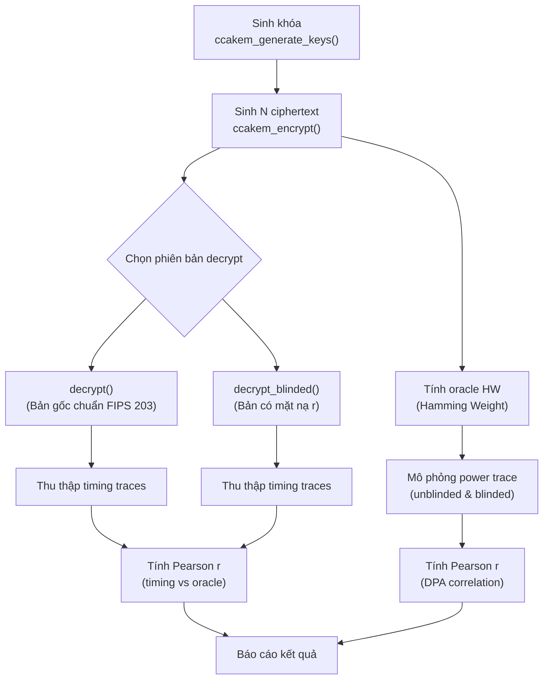

# CRYSTALS-Kyber — Triển khai và Đánh giá An toàn Kênh bên (KyberGuard)


-green)
[](https://github.com/PyryL/kyber/actions/workflows/main.yml)
[](https://codecov.io/gh/PyryL/kyber)

---

## 1. Tổng quan dự án

Dự án triển khai thuật toán mã hóa hậu lượng tử **CRYSTALS-Kyber** (phiên bản **Kyber1024**) bằng ngôn ngữ Python, đồng thời nghiên cứu và đánh giá các biện pháp **bảo vệ chống tấn công kênh phụ** (Side-Channel Attack). Cụ thể, dự án bao gồm:

- **Triển khai đầy đủ** cơ chế đóng gói khóa IND-CCA2 (KEM) theo đặc tả NIST FIPS 203 (ML-KEM, tên chuẩn hóa của Kyber).
- **Đề xuất và triển khai kỹ thuật NTT Blinding** — kỹ thuật che giấu khóa bí mật trong miền NTT nhằm chống lại tấn công phân tích năng lượng vi sai (DPA) và tấn công định thời (Timing Attack).
- **Mô phỏng tấn công kênh phụ** (Timing Attack, DPA theo mô hình Hamming Weight) để chứng minh hiệu quả của biện pháp bảo vệ.
- **So sánh hiệu năng** giữa hai phiên bản: NTT gốc (không bảo vệ) và NTT + Blinding (có bảo vệ kênh phụ).

---

## 2. Tổng quan bài toán

### 2.1. Bối cảnh

Khi hai bên muốn trao đổi thông tin an toàn qua mạng không bảo mật, họ cần mã hóa. Phương pháp phổ biến là sử dụng **Cơ chế Đóng gói Khóa (KEM)**: hai bên thỏa thuận một khóa chung thông qua mã hóa bất đối xứng, sau đó dùng khóa này để mã hóa đối xứng (ví dụ AES) cho dữ liệu thực tế.

Các thuật toán trao đổi khóa truyền thống (RSA, Diffie–Hellman, ECDH) đều dựa trên bài toán phân tích số nguyên hoặc logarit rời rạc — những bài toán mà **thuật toán Shor** trên máy tính lượng tử có thể giải trong thời gian đa thức. Do đó, NIST đã chuẩn hóa **CRYSTALS-Kyber** (ML-KEM) làm thuật toán KEM hậu lượng tử đầu tiên (FIPS 203, 2024).

### 2.2. Bài toán nền tảng — Module-LWE

Kyber dựa trên bài toán **Module Learning With Errors (M-LWE)** trên vành đa thức:

$$R_q = \mathbb{Z}_q[x] / (x^n + 1), \quad n = 256, \quad q = 3329$$

Cho ma trận $\mathbf{A} \in R_q^{k \times k}$, vector bí mật $\mathbf{s} \in R_q^k$ với hệ số nhỏ, và vector nhiễu $\mathbf{e}$ với hệ số nhỏ, bài toán yêu cầu tìm $\mathbf{s}$ từ:

$$\mathbf{t} = \mathbf{A} \cdot \mathbf{s} + \mathbf{e}$$

Bài toán này được cho là khó giải ngay cả với máy tính lượng tử, tạo nền tảng an toàn cho Kyber.

### 2.3. Vấn đề tấn công kênh phụ

Ngoài tấn công toán học, hệ mật còn có thể bị khai thác thông qua **kênh phụ vật lý** — thông tin rò rỉ từ thời gian thực thi, mức tiêu thụ năng lượng, hay bức xạ điện từ. Dự án nghiên cứu hai loại tấn công chính:

| Loại tấn công | Mô tả | Mô hình mô phỏng |
|---|---|---|
| **Timing Attack** | Thời gian giải mã phụ thuộc vào giá trị khóa bí mật | Đo `time.perf_counter_ns()` qua $N$ lần decrypt |
| **DPA** (Differential Power Analysis) | Năng lượng tiêu thụ tương quan với dữ liệu trung gian | Mô hình Hamming Weight: $\text{power} \sim HW(\text{kết quả trung gian})$ |

---

## 3. Mô tả nội dung

Dự án triển khai đầy đủ pipeline mã hóa/giải mã Kyber1024 và kỹ thuật bảo vệ kênh phụ:

```
Alice                                    Bob
  │                                        │
  ├─ (sk, pk) = generate_keys()            │
  │                                        │
  ├────────── pk ─────────────────────────►│
  │                                        │
  │                        (c, K) = encrypt(pk)
  │                                        │
  │◄──────── c ────────────────────────────┤
  │                                        │
  ├─ K = decrypt(sk, c)                    │
  │                                        │
  │  K giống nhau ở hai phía               │
  │  => Dùng K làm khóa AES               │
  └────────────────────────────────────────┘
```

### Các tính năng chính

1. **Sinh khóa (KeyGen)**: Sinh ma trận $\mathbf{A}$ từ seed, vector bí mật $\mathbf{s}$ và nhiễu $\mathbf{e}$ qua phân phối CBD, tính $\mathbf{t} = \mathbf{A}\mathbf{s} + \mathbf{e}$.
2. **Mã hóa (Encrypt)**: Tạo bản mã $(u, v)$ với $u = \mathbf{A}^T \mathbf{r} + \mathbf{e}_1$ và $v = \mathbf{t}^T \mathbf{r} + e_2 + \lceil q/2 \rceil \cdot m$.
3. **Giải mã (Decrypt)**: Tính $m = v - \mathbf{s}^T \mathbf{u}$ rồi làm tròn để phục hồi thông điệp gốc.
4. **CCA-KEM**: Bọc CPAPKE bằng biến đổi Fujisaki–Okamoto để đạt an toàn IND-CCA2.
5. **NTT Blinding**: Che giấu $\mathbf{s}$ bằng vector ngẫu nhiên $\mathbf{r}$ trong miền NTT, tính toán trên $\mathbf{s}^* = \mathbf{s} + \mathbf{r}$ rồi khử $\mathbf{r}$ sau — khóa bí mật không bao giờ xuất hiện đơn lẻ trong phép tính.
6. **Mô phỏng tấn công**: Timing Attack và DPA với hệ số tương quan Pearson để đo lường hiệu quả bảo vệ.

---

## 4. Mô tả các module dự án

### 4.1. Cấu trúc thư mục

```
kyber/
├── kyber/                          # Package chính của hệ thống KyberGuard
│   ├── constants.py                # Tham số Kyber1024 theo FIPS 203 (q=3329, n=256, k=4)
│   ├── ccakem.py                   # IND-CCA2 KEM (Biến đổi Fujisaki–Okamoto)
│   ├── side_channel_poc.py         # Mô phỏng tấn công kênh bên (Timing & DPA)
│   ├── encryption/                 # CPAPKE: mã hóa/giải mã khóa công khai
│   │   ├── __init__.py
│   │   ├── keygen.py               # Sinh cặp khóa CPAPKE
│   │   ├── encrypt.py              # Mã hóa CPAPKE
│   │   ├── decrypt.py              # Giải mã chuẩn FIPS 203 (Bản gốc, chưa có mặt nạ)
│   │   └── decrypt_blinded.py      # Giải mã cải tiến có mặt nạ r (Bản bảo vệ kênh bên)
│   ├── entities/
│   │   └── polring.py              # Cấu trúc dữ liệu vành đa thức PolynomialRing
│   └── utils/                      # Các hàm toán học và tiện ích bổ trợ
│       ├── ntt.py                  # Biến đổi số học NTT (Cooley-Tukey, base-mul)
│       ├── byte_conversion.py      # Chuyển đổi byte ↔ integer ↔ bit array
│       ├── cbd.py                  # Centered Binomial Distribution sampling
│       ├── compression.py          # Nén/giải nén hệ số đa thức modulo q
│       ├── encoding.py             # Mã hóa/giải mã đa thức ↔ byte array
│       ├── parse.py                # Rejection sampling từ XOF sang đa thức
│       ├── pseudo_random.py        # Các hàm băm SHA-3 (H, G, KDF, XOF, PRF)
│       └── round.py                # Hàm làm tròn chuẩn (half-up rounding)
├── tests/                          # 70 unit tests kiểm thử tính đúng đắn (pytest)
├── perf_tests/                     # Benchmark hiệu năng KEM và tích hợp AES-GCM
├── analysis/                       # Script phân tích so sánh Kyber vs AES
├── docs/                           # Tài liệu thiết kế (requirements, implementation, tests, usage)
├── images/                         # Đồ thị phân tán (scatter plots) và hình ảnh báo cáo
├── cli.py                          # Giao diện dòng lệnh (CLI keygen, encrypt, decrypt)
├── main.py                         # Điểm khởi chạy demo KEM cơ bản
├── demo_comparison.py              # Benchmark & so sánh Bản gốc vs Bản có mặt nạ r
├── test_dpa_quick.py               # Script kiểm tra nhanh độ giảm tương quan DPA
├── export_figures.py               # Tự động xuất biểu đồ phân giải cao cho báo cáo LaTeX
├── tasks.py                        # Task runner tự động hóa (invoke: test, lint, perf)
├── pyproject.toml                  # Cấu hình dự án và dependencies qua Poetry
└── poetry.lock                     # Khóa phiên bản các gói phụ thuộc
```

### 4.2. Chi tiết các module

#### `kyber/constants.py` — Tham số Kyber1024

| Tham số | Giá trị | Ý nghĩa |
|---------|---------|---------|
| `n` | 256 | Bậc đa thức (kích thước plaintext theo bit) |
| `q` | 3329 | Modulus của vành đa thức $R_q$ |
| `k` | 4 | Chiều ma trận (Kyber1024 — mức bảo mật cao nhất) |
| `η₁` | 2 | Tham số nhiễu cho khóa bí mật và vector $\mathbf{r}$ |
| `η₂` | 2 | Tham số nhiễu cho $\mathbf{e}_1, e_2$ |
| `dᵤ` | 11 | Bit nén cho $\mathbf{u}$ (trong bản mã) |
| `dᵥ` | 5 | Bit nén cho $v$ (trong bản mã) |

> **Mức bảo mật**: Kyber1024 tương đương AES-256, đạt mức an toàn NIST Level 5.

#### `kyber/encryption/` — CPAPKE (Mã hóa/Giải mã lõi)

- **`keygen.py`**: Sinh cặp khóa $(sk, pk)$.
  - Sinh seed ngẫu nhiên 32 bytes → tách $(\rho, \sigma)$ qua SHA-3 `G`.
  - Tạo ma trận $\mathbf{A} \in R_q^{k \times k}$ từ $\rho$ qua hàm `parse(XOF(...))`.
  - Sinh $\mathbf{s}, \mathbf{e}$ qua phân phối CBD từ $\sigma$.
  - Tính $\mathbf{t} = \mathbf{A}\mathbf{s} + \mathbf{e}$.

- **`encrypt.py`**: Mã hóa thông điệp 32 bytes thành bản mã.
  - Tái tạo $\mathbf{A}$ từ $\rho$ trong khóa công khai.
  - Sinh vector ngẫu nhiên $\mathbf{r}, \mathbf{e}_1, e_2$ qua CBD.
  - Tính $\mathbf{u} = \mathbf{A}^T\mathbf{r} + \mathbf{e}_1$ và $v = \mathbf{t}^T\mathbf{r} + e_2 + \text{Decompress}(m)$.
  - Nén và mã hóa thành byte array.

- **`decrypt.py`**: **Giải mã bản gốc (Baseline)** theo chuẩn FIPS 203 (chưa che mặt nạ).
  - Thực hiện giải mã chuẩn: chuyển $\mathbf{s}, \mathbf{u}$ sang miền biến đổi, tính tích vô hướng $\mathbf{s}^T \mathbf{u}$ rồi phục hồi bản rõ.

- **`decrypt_blinded.py`**: **Giải mã cải tiến có mặt nạ $\mathbf{r}$** (đóng góp chính).
  - Che giấu khóa bí mật: $\hat{\mathbf{s}}^* = \hat{\mathbf{s}} + \hat{\mathbf{r}}$ với $\hat{\mathbf{r}}$ sinh ngẫu nhiên trực tiếp bằng CSPRNG.
  - Tính toán phân tách: $\hat{\mathbf{s}}^{*T}\hat{\mathbf{u}} - \hat{\mathbf{r}}^T\hat{\mathbf{u}} = \hat{\mathbf{s}}^T\hat{\mathbf{u}}$.
  - Xóa an toàn (zeroization) toàn bộ các biến trung gian sau khi sử dụng để chống rò rỉ bộ nhớ.

#### `kyber/ccakem.py` — IND-CCA2 KEM

Bọc CPAPKE bằng biến đổi Fujisaki–Okamoto:
- `ccakem_generate_keys()`: Sinh khóa KEM (bao gồm $sk + pk + H(pk) + z$).
- `ccakem_encrypt(pk)`: Tạo shared secret 32 bytes + bản mã.
- `ccakem_decrypt(c, sk)`: Giải mã bản mã, kiểm tra tính hợp lệ để chống tấn công CCA.

#### `kyber/utils/ntt.py` — Number Theoretic Transform

Triển khai NTT chuẩn Kyber với $\zeta = 17$ (căn nguyên thủy bậc 256 mod $q$):
- `ntt()`: Forward NTT — Cooley-Tukey butterfly, $O(n \log n)$.
- `intt()`: Inverse NTT — Gentleman-Sande butterfly, $O(n \log n)$.
- `mul_ntt()`: Nhân trong miền NTT — 128 base-mul, $O(n)$.
- `dot_product_ntt()`: Tích vô hướng vector NTT — $O(k \cdot n)$.
- `add_ntt()`, `sub_ntt()`: Cộng/trừ hệ số theo vị trí mod $q$.

#### `kyber/entities/polring.py` — Vành đa thức

Lớp `PolynomialRing` đại diện cho phần tử trong $R_q$, hỗ trợ:
- Phép cộng, trừ, nhân đa thức (với reduction modulo $x^{256} + 1$).
- So sánh bằng.
- Kiểm tra giới hạn hệ số.

#### `kyber/utils/` — Tiện ích

| Module | Chức năng |
|--------|-----------|
| `pseudo_random.py` | Các hàm SHA-3: `H` (SHA3-256), `G` (SHA3-512), `KDF` (SHAKE-256), `XOF` (SHAKE-128), `PRF` (SHAKE-256) |
| `cbd.py` | Centered Binomial Distribution — sinh đa thức có hệ số nhỏ từ byte array |
| `compression.py` | Nén hệ số từ mod $q$ xuống $d$ bit và giải nén ngược lại |
| `encoding.py` | Mã hóa/giải mã `PolynomialRing` ↔ byte array |
| `parse.py` | Parse byte stream (XOF output) thành `PolynomialRing` |
| `byte_conversion.py` | Chuyển đổi integer ↔ bytes ↔ bit array |
| `round.py` | Hàm làm tròn chuẩn (ties rounded up, không away-from-zero) |

#### `kyber/side_channel_poc.py` — Mô phỏng tấn công kênh phụ

Module mô phỏng hai loại tấn công:

1. **Timing Attack**: Đo thời gian decrypt $N$ lần, tính hệ số biến thiên (CV) và Pearson $r$ giữa timing và oracle.
2. **DPA (Differential Power Analysis)**: Target một cặp hệ số cụ thể trong base-mul, so sánh oracle $HW(s \cdot u)$ với power trace.
3. **Verify Correctness**: Kiểm chứng `decrypt() == decrypt_blinded()` trên nhiều cặp khóa độc lập.

---

## 5. Cách triển khai dự án

### 5.1. Yêu cầu hệ thống

- **Hệ điều hành**:
  - **Khuyến nghị cho benchmark**: **Ubuntu 22.04 LTS** (hoặc 24.04 LTS) trên **Windows Subsystem for Linux 2 (WSL2)** nhằm loại bỏ độ trễ và jitter lập lịch ngẫu nhiên của Windows, mang lại kết quả đo thời gian hằng số và phân tích tương quan nhất quán.
  - **Tương thích**: Microsoft Windows 11 / Windows 10 (64-bit).
- **Python**: CPython **3.12.10** (đáp ứng ràng buộc $\geq 3.11, < 3.13$ của dự án).
- **Trình quản lý gói**: [Poetry](https://python-poetry.org/) ($\geq 1.5.0$).
- **Phần cứng thử nghiệm**: Intel Core (Family 6 Model 140, 8 luồng xử lý), RAM 15.73 GB ($\approx 16$ GB).

### 5.2. Cài đặt môi trường

#### Cách 1: Thiết lập trên WSL2 Ubuntu (Môi trường chuẩn cho thực nghiệm benchmark)

```bash
# 1. Di chuyển vào thư mục dự án từ WSL
cd "/mnt/d/Luan Van Nghien Cuu/Lattice_Based Cryptography_Kyber/kyber"

# 2. Cài đặt Python 3.12 và Poetry (nếu máy WSL chưa có)
sudo apt update && sudo apt install -y python3.12 python3.12-venv python3.12-dev curl build-essential
curl -sSL https://install.python-poetry.org | python3 -
export PATH="$HOME/.local/bin:$PATH"

# 3. Kích hoạt môi trường và cài đặt các phụ thuộc
poetry env use python3.12
poetry install
```

#### Cách 2: Thiết lập trực tiếp trên Windows (PowerShell)

```powershell
# 1. Di chuyển vào thư mục dự án
cd "d:\Luan Van Nghien Cuu\Lattice_Based Cryptography_Kyber\kyber"

# 2. Cài đặt dependencies qua Poetry
poetry install
```

**Danh sách thư viện phụ thuộc:**

| Thư viện | Phiên bản thực tế | Vai trò |
|----------|-------------------|---------|
| `numpy` | 1.26.1 | Thao tác ma trận và mảng hệ số đa thức |
| `pycryptodome` | 3.19.0 | Hàm băm SHA-3 chuẩn FIPS 202 (SHA3-256, SHA3-512, SHAKE-128, SHAKE-256) |
| `matplotlib` | 3.8.2 | Trực quan hóa dữ liệu và xuất biểu đồ phân tán (scatter plots) |
| `pytest` | 7.4.3 | Framework kiểm thử đơn vị tự động |
| `invoke` | 2.2.0 | Task runner tự động hóa (test, benchmark, lint) |
| `secrets` | (built-in) | CSPRNG cấp hệ điều hành (gọi `getrandom()` trên Linux/WSL) phục vụ tạo mặt nạ $\mathbf{r}$ |

### 5.3. Sử dụng cơ bản

#### Qua Python

```python
from kyber.ccakem import ccakem_generate_keys, ccakem_encrypt, ccakem_decrypt

# Sinh khóa
private_key, public_key = ccakem_generate_keys()

# Mã hóa (phía gửi)
ciphertext, shared_secret = ccakem_encrypt(public_key)

# Giải mã (phía nhận)
shared_secret2 = ccakem_decrypt(ciphertext, private_key)

assert shared_secret == shared_secret2  # Khóa chung giống nhau!
```

#### Qua CLI

```bash
# Sinh khóa
poetry run python cli.py keygen private.txt
poetry run python cli.py pubkey --output public.txt private.txt

# Mã hóa
poetry run python cli.py encrypt --key public.txt --secret secret.txt --cipher cipher.txt

# Giải mã
poetry run python cli.py decrypt --key private.txt --output secret.txt cipher.txt
```

### 5.4. Chạy kiểm thử tự động

```bash
# Chạy toàn bộ 70 unit tests với chi tiết từng testcase
poetry run pytest -v

# Hoặc qua task runner invoke
poetry run invoke test

# Đo lường độ bao phủ mã nguồn (Coverage report)
poetry run invoke coverage-report
```

### 5.5. Chạy thực nghiệm đánh giá an toàn kênh bên

```bash
# 1. Chạy so sánh đầy đủ: verify tính đúng đắn + benchmark hiệu năng + mô phỏng tấn công
poetry run python demo_comparison.py

# 2. Chế độ kiểm tra nhanh (quick mode)
poetry run python demo_comparison.py --quick

# 3. Kiểm tra nhanh tương quan DPA (Hamming Weight model)
poetry run python test_dpa_quick.py

# 4. Tự động xuất biểu đồ phân giải cao (scatter plots) cho báo cáo LaTeX
poetry run python export_figures.py
```

> **Lưu ý trên Windows PowerShell**: Nếu gặp lỗi mã hóa ký tự Unicode bảng, thêm cờ `-X utf8`:
> `poetry run python -X utf8 demo_comparison.py`

---

## 6. Thiết lập thực nghiệm

### 6.1. Cấu hình môi trường thực nghiệm thực tế

| Thành phần | Thông số thực tế triển khai |
|---|---|
| **Hệ điều hành** | **Ubuntu 22.04 LTS (x86_64) trên WSL2** (Host: Microsoft Windows 11 64-bit) |
| **CPU** | Intel64 Family 6 Model 140 Stepping 1, GenuineIntel (8 luồng xử lý) |
| **RAM** | 15.73 GB (tương đương 16 GB RAM) |
| **Python Runtime** | CPython 3.12.10 64-bit (quản lý bởi Poetry, tương thích $\geq 3.11, < 3.13$) |
| **Tiêu chuẩn áp dụng** | NIST FIPS 203 (ML-KEM-1024), sử dụng toàn bộ biến đổi NTT trong vành $\mathcal{R}_q$ |

### 6.2. Compiler và Runtime

| Thành phần | Chi tiết |
|---|---|
| **Ngôn ngữ** | Python 3.12.10 (interpreted, CPython) |
| **Thư viện mã hóa** | PyCryptodome 3.19.0 — SHA-3 thuần (không accelerator phần cứng) |
| **Thư viện toán** | NumPy 1.26.1 — phép nhân ma trận đa thức (C backend) |
| **NTT** | Pure Python — giúp quan sát rõ side-channel (không bị tối ưu hóa che lấp) |
| **Môi trường đo lường** | WSL2 (Linux POSIX) — giảm thiểu hiện tượng jitter của Windows OS scheduler |

> **Tại sao ưu tiên WSL2 Ubuntu cho benchmark an toàn kênh bên?**
> Trong các bài đo lường thời gian vi mô (nanosecond / microsecond qua `time.perf_counter_ns()`), môi trường Linux POSIX trên WSL2 có độ ổn định lập lịch (process scheduling) cao hơn, hạn chế các ngắt gián đoạn hệ thống ngẫu nhiên của các dịch vụ nền Windows, từ đó cung cấp các mẫu đo thời gian có phương sai thấp và kết quả phân tích tương quan Pearson $r$ đáng tin cậy hơn.

### 6.3. Cách đo hiệu năng

#### Đo thời gian (Timing Benchmark)

```python
# Mỗi ciphertext được decrypt 3 lần, lấy trung vị (median)
# để loại bỏ nhiễu do scheduler OS, garbage collection, v.v.
for ct in ciphertexts:
    times = []
    for _ in range(3):
        t0 = time.perf_counter_ns()       # Độ phân giải nanosecond
        decrypt(sk, ct)
        elapsed = time.perf_counter_ns() - t0
        times.append(elapsed / 1_000)     # Chuyển sang microsecond (µs)
    result = statistics.median(times)
```

**Các chỉ số đo:**

| Chỉ số | Công thức | Ý nghĩa |
|--------|-----------|---------|
| Mean | $\bar{t} = \frac{1}{N}\sum t_i$ | Thời gian trung bình |
| StdDev | $\sigma = \sqrt{\frac{1}{N-1}\sum(t_i - \bar{t})^2}$ | Độ lệch chuẩn |
| CV | $CV = \frac{\sigma}{\bar{t}} \times 100\%$ | Hệ số biến thiên (đo tính constant-time) |
| Overhead | $\frac{\bar{t}_{\text{blind}} - \bar{t}_{\text{ntt}}}{\bar{t}_{\text{ntt}}} \times 100\%$ | Chi phí thêm của blinding |

#### Đo tương quan kênh phụ (Side-Channel Correlation)

```python
# Hệ số tương quan Pearson r ∈ [-1, 1]
# |r| > 0.5 => tấn công có thể thành công
# |r| < 0.1 => tấn công bị chặn hiệu quả
r = pearson_correlation(oracle_power, measured_trace)
```

### 6.4. Tham số thực nghiệm

| Tham số | Giá trị mặc định | Mô tả |
|---------|-------------------|-------|
| `num_samples` (timing) | 80 | Số ciphertext dùng trong timing attack |
| `num_trials` (DPA) | 120 | Số lần decrypt cho DPA |
| `noise_std` | 1.5 (hoặc 2% giá trị oracle) | Nhiễu đo lường mô phỏng |
| Repetitions/sample | 3 | Số lần lặp mỗi phép đo (lấy median) |
| `_POL_TARGET` | 0 | Polynomial mục tiêu trong tấn công DPA |
| `_PAIR_TARGET` | 0 | Cặp hệ số mục tiêu trong base-mul |

### 6.5. Biến thể Kyber được thực nghiệm

| Biến thể | $k$ | $\eta_1$ | $\eta_2$ | $d_u$ | $d_v$ | Mức NIST |
|----------|-----|----------|----------|-------|-------|----------|
| **Kyber1024** (dự án này) | 4 | 2 | 2 | 11 | 5 | Level 5 (~AES-256) |

---

## 7. Môi trường và công cụ triển khai đánh giá an toàn

### 7.1. Kiến trúc đánh giá



### 7.2. Công cụ đo lường

| Công cụ | Mục đích | Chi tiết |
|---------|----------|----------|
| `time.perf_counter_ns()` | Đo thời gian thực thi | Độ phân giải nanosecond, không bị ảnh hưởng bởi system clock adjustment |
| `statistics.median()` | Lọc nhiễu timing | Lấy trung vị từ 3 lần chạy mỗi mẫu |
| `statistics.stdev()` | Đo biến động | Tính độ lệch chuẩn của timing distribution |
| `pearson_r()` (tự triển khai) | Đo tương quan | Hệ số tương quan Pearson giữa oracle và trace |
| `secrets.token_bytes()` | CSPRNG | Sinh số ngẫu nhiên bảo mật (OS entropy) |

### 7.3. Mô hình tấn công

#### Timing Attack

- **Giả thuyết**: Thời gian decrypt phụ thuộc vào giá trị ciphertext/khóa.
- **Phương pháp**: Decrypt $N$ ciphertext khác nhau, đo timing, tính Pearson $r$ giữa timing và oracle HW.
- **Kỳ vọng**:
  - NTT gốc: $|r|$ có thể đáng kể → rò rỉ timing.
  - NTT Blinded: $|r| \approx 0$ → timing không tương quan.

#### DPA — Differential Power Analysis

- **Mô hình**: Hamming Weight (HW) — năng lượng tiêu thụ tỷ lệ với số bit 1 của kết quả phép tính.
- **Target**: Một cặp hệ số cụ thể trong phép base-mul:

$$\text{oracle} = HW\bigl(s[0] \cdot u[0] + s[1] \cdot u[1] \cdot \zeta \mod q\bigr)$$

- **Tại sao target một cặp**: Nếu lấy tổng tất cả 512 phép nhân, Luật Số Lớn (LLN) triệt tiêu phương sai → $r \approx 0$ cho cả hai phiên bản. DPA thực tế luôn target từng bit/byte.
- **Trace mô phỏng**:
  - Unblinded: $\text{trace} = \text{oracle} + \mathcal{N}(0, \sigma)$ (nhiễu đo lường nhỏ)
  - Blinded: $\text{trace} = HW\bigl((s + r_{\text{random}}) \cdot u\bigr)$ → không tương quan

### 7.4. Kỹ thuật bảo vệ: NTT Domain Blinding

```
Phép tính gốc (dễ bị tấn công):
    m = INTT( s_hat ⊙ u_hat )        ← s_hat xuất hiện trực tiếp

Phép tính có blinding (được bảo vệ):
    r_hat  ← random (sinh trực tiếp trong NTT domain)
    s*_hat = s_hat + r_hat            ← s_hat bị che giấu
    result = INTT( s*_hat ⊙ u_hat  -  r_hat ⊙ u_hat )
           = INTT( s_hat ⊙ u_hat )   ← kết quả chính xác!
```

**Ưu điểm của cơ chế che mặt nạ r:**

| Tiêu chí | Bản gốc (chưa bảo vệ) | Bản có mặt nạ r (bảo vệ) |
|----------|------------------------:|-------------------------:|
| Khóa bí mật $\mathbf{s}$ | Xuất hiện trực tiếp trong phép tính | Luôn được che giấu: $\mathbf{s} + \mathbf{r}$ |
| Bảo vệ kênh bên (DPA) | ❌ Không (dễ bị tấn công) | ✅ Có (triệt tiêu tương quan) |
| Overhead thời gian | Baseline | $< 20\%$ (thực tế $\approx 7.5\%$) |
| Tính đúng đắn | ✅ Chuẩn FIPS 203 | ✅ Kết quả giống hệt bản gốc |

### 7.5. Tiêu chí đánh giá

| Tiêu chí | Ngưỡng chấp nhận | Phương pháp đo |
|----------|-------------------|----------------|
| **Tính đúng đắn** | `decrypt(sk, c) == decrypt_blinded(sk, c)` ∀ test cases | Verify correctness trên các cặp khóa |
| **DPA correlation (gốc)** | $\|r\| > 0.5$ (chứng minh rò rỉ kênh bên) | Pearson $r$ trên mẫu đo |
| **DPA correlation (mặt nạ)** | $\|r\| < 0.1$ (tấn công bị chặn hoàn toàn) | Pearson $r$ trên mẫu đo |
| **Overhead** | $< 20\%$ (ngưỡng khống chế) | So sánh mean timing Bản gốc vs Bản có mặt nạ |
| **Reduction** | $> 90\%$ giảm tương quan DPA | $\bigl(1 - \frac{\|r_{\text{blind}}\|}{\|r_{\text{orig}}\|}\bigr) \times 100\%$ |

### 7.6. Hệ thống CI/CD

Dự án sử dụng GitHub Actions để tự động chạy test trên mỗi commit:

```yaml
# .github/workflows/main.yml
- Chạy trên: ubuntu-latest
- Python: 3.11, 3.12
- Bước: install → pytest → coverage → upload codecov
```

---

## 8. Tài liệu tham khảo

1. Avanzi, R. et al.: *CRYSTALS-Kyber Algorithm Specifications and Supporting Documentation* (v3.02, 2021). [PDF](https://pq-crystals.org/kyber/data/kyber-specification-round3-20210804.pdf)
2. NIST FIPS 203: *Module-Lattice-Based Key-Encapsulation Mechanism Standard* (ML-KEM, 2024).
3. NIST: *NIST Announces First Four Quantum-Resistant Cryptographic Algorithms* (2022). [Link](https://www.nist.gov/news-events/news/2022/07/nist-announces-first-four-quantum-resistant-cryptographic-algorithms)
4. Cryptopedia: *Kyber – How does it work?* [Link](https://cryptopedia.dev/posts/kyber/)
5. Wikipedia: *Key Encapsulation Mechanism*. [Link](https://en.wikipedia.org/wiki/Key_encapsulation_mechanism)

---

## Tài liệu bổ sung trong dự án

| Tài liệu | Mô tả |
|-----------|-------|
| [docs/requirements.md](docs/requirements.md) | Đặc tả yêu cầu |
| [docs/implementation.md](docs/implementation.md) | Chi tiết triển khai |
| [docs/tests.md](docs/tests.md) | Báo cáo kiểm thử |
| [docs/usage.md](docs/usage.md) | Hướng dẫn sử dụng |

---

## License

Dự án phục vụ mục đích nghiên cứu và học thuật.
