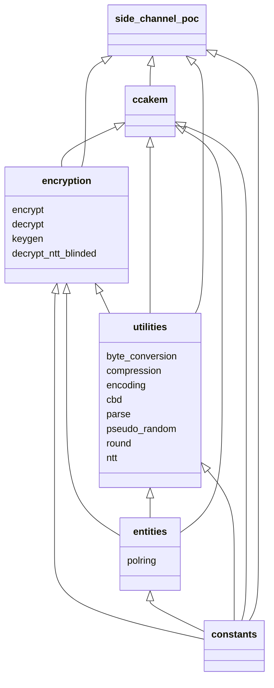

# Implementation

> **Provenance Notice:**
> The original baseline architecture of this repository was designed and implemented by **Pyry L** ([https://github.com/PyryL/kyber](https://github.com/PyryL/kyber)). This document describes the foundational architecture along with the **NTT optimization, side-channel protection (NTT Domain Blinding), and security evaluation modules** added in this enhanced version.

---

## Project Structure

This project is organized into hierarchical packages and modules where each component handles a focused scope of cryptographic operations. Higher-level packages depend on strictly lower or peer modules.

Below is the diagram illustrating the current package and module hierarchy:

### Module Roles Overview

* **`constants`**: Defines Kyber1024 parameters ($n=256$, $q=3329$, $k=4$, $\eta_1=2$, $\eta_2=2$, $d_u=11$, $d_v=5$) and precomputed NTT tables.
* **`entities`**: Contains fundamental algebraic structures (`PolynomialRing` for $\mathcal{R}_q = \mathbb{Z}_q[x]/(x^{256} + 1)$).
* **`utilities`**: Provides low-level mathematical and data-transformation utilities (byte packing, compression, CBD sampling, SHA-3 hashing, and NTT).
* **`encryption`**: Implements CPAPKE key generation, encryption, original decryption, and hardened NTT-blinded decryption.
* **`ccakem`**: Implements the Fujisaki-Okamoto (FO) transform providing IND-CCA2 security with implicit rejection.
* **`side_channel_poc`**: Provides side-channel vulnerability testing, Timing Attack simulation, and Differential Power Analysis (DPA) modeling.

---

## Core Modules & Mathematical Primitives

### 1. Polynomial Ring (`entities/polring.py`)
Elements of the quotient ring $\mathcal{R}_q = \mathbb{Z}_q[x]/(x^{256} + 1)$ are represented by the `PolynomialRing` class. In the baseline implementation (by Pyry L), polynomial addition, subtraction, and schoolbook multiplication $O(n^2)$ are supported.

### 2. Number Theoretic Transform (`utils/ntt.py`) *(Enhanced)*
To eliminate the $O(n^2)$ computational bottleneck of schoolbook multiplication, Kyber standardizes the Number Theoretic Transform (Algorithm 1–4, Kyber v3.02).

* **Parameters:** $q = 3329$, $n = 256$, primitive 256th root of unity $\zeta = 17$ (where $17^{128} \equiv -1 \pmod q$ and $17^{256} \equiv 1 \pmod q$).
* **Forward NTT (`ntt`):** In-place Cooley-Tukey butterfly network over 7 stages using precomputed bit-reversed powers $\zeta^{\text{bitrev}_7(k)} \bmod q$. Complexity: $O(n \log n)$.
* **Inverse NTT (`intt`):** Gentleman-Sande butterfly network normalized by $128^{-1} \equiv 3303 \pmod q$. Complexity: $O(n \log n)$.
* **Base Multiplication (`mul_ntt`):** Because $x^{256} + 1 = \prod_{i=0}^{127} (x^2 - \zeta^{2\cdot\text{bitrev}_7(i)+1}) \pmod q$, multiplication in $\mathcal{R}_q$ reduces to 128 independent degree-1 polynomial multiplications modulo $(x^2 - \zeta_i)$:
  $$(a_0 + a_1 x)(b_0 + b_1 x) \equiv (a_0 b_0 + a_1 b_1 \zeta_i) + (a_0 b_1 + a_1 b_0) x \pmod{x^2 - \zeta_i}$$
  Requires only $128 \times 4 = 512$ modular multiplications, compared to $256^2 = 65{,}536$ in schoolbook mode ($\sim 128\times$ fewer operations).
* **Inner Product (`dot_product_ntt`):** Computes $\sum_{i=0}^{k-1} \hat{\mathbf{a}}_i \odot \hat{\mathbf{b}}_i$ directly in the NTT domain in $O(k \cdot n)$ time.

### 3. Basic Utilities
* **`byte_conversion.py`**: Conversions between integers, bit arrays, and byte arrays.
* **`compression.py`**: Compresses polynomial coefficients modulo $q$ down to $d$ bits via $\lceil (2^d / q) \cdot x \rfloor \bmod 2^d$, and decompresses back.
* **`encoding.py`**: Serializes polynomials with bounded coefficients into packed byte strings and reconstructs them.
* **`cbd.py`**: Samples polynomials from Centered Binomial Distribution with parameter $\eta$.
* **`parse.py`**: Rejection sampling from SHAKE-128 stream into uniformly distributed ring elements.
* **`pseudo_random.py`**: Cryptographic functions based on PyCryptodome: SHA3-256 ($H$), SHA3-512 ($G$), SHAKE-128 (XOF), SHAKE-256 (PRF, KDF).
* **`round.py`**: Half-up rounding implementation.

---

## Side-Channel Hardening: NTT Domain Blinding

In standard CPAPKE decryption, the secret key polynomial vector $\mathbf{s}$ is directly multiplied by the ciphertext polynomial vector $\mathbf{u}$. A physical adversary monitoring power consumption or electromagnetic radiation can extract $\mathbf{s}$ using Differential Power Analysis (DPA).

### Why Schoolbook Blinding is Inefficient
In the polynomial domain, computing $(\mathbf{s} + \mathbf{r})^\top \mathbf{u} - \mathbf{r}^\top \mathbf{u}$ requires two full polynomial matrix-vector products $O(k \cdot n^2)$, adding an overhead of $\sim 85\%$.

### The NTT Domain Blinding Architecture (`encryption/decrypt_ntt_blinded.py`)
Our enhanced implementation performs blinding entirely inside the NTT domain:

1. **Direct NTT Vector Sampling:**
   Using OS CSPRNG (`secrets.token_bytes`), a random masking vector $\hat{\mathbf{r}} \in \mathbb{Z}_q^{k \times n}$ is sampled **directly in the NTT domain**. Because NTT is an invertible linear isomorphism, uniformly distributed coefficients in the NTT domain correspond to uniform polynomials in $\mathcal{R}_q$, eliminating the $O(k \cdot n \log n)$ cost of computing $\text{NTT}(\mathbf{r})$.

2. **Secret Key Masking:**
   The secret key in the NTT domain $\hat{\mathbf{s}}$ is masked immediately:
   $$\hat{\mathbf{s}}^* = \hat{\mathbf{s}} + \hat{\mathbf{r}} \pmod q$$
   The true secret $\hat{\mathbf{s}}$ is never multiplied alone.

3. **Algebraic Decoupling:**
   The receiver calculates two NTT inner products:
   $$\widehat{s^* u} = \text{dot\_product\_ntt}(\hat{\mathbf{s}}^*, \hat{\mathbf{u}})$$
   $$\widehat{ru} = \text{dot\_product\_ntt}(\hat{\mathbf{r}}, \hat{\mathbf{u}})$$
   The unmasked inner product is recovered by subtraction:
   $$\widehat{su} = \widehat{s^* u} - \widehat{ru} = \hat{\mathbf{s}}^\top \odot \hat{\mathbf{u}} \pmod q$$

4. **Reconstruction & Secure Erasure:**
   $\mathbf{s}^\top \mathbf{u} = \text{INTT}(\widehat{su})$ is computed, followed by $m = v - \mathbf{s}^\top \mathbf{u}$.
   All intermediate buffers ($\hat{\mathbf{r}}, \hat{\mathbf{s}}^*, \widehat{s^* u}, \widehat{ru}$) are immediately overwritten with zeros (`_erase_vector`, `_erase_list`) to prevent memory exposure.

* **Resulting Overhead:** Only $+7.5\%$ over unblinded NTT decryption, well within the target threshold ($< 20\%$).

---

## Side-Channel Attack Proof-of-Concept (`side_channel_poc.py`)

To evaluate the security improvement empirically, `side_channel_poc.py` simulates realistic attack scenarios:

1. **Timing Attack:**
   Measures execution time distributions across $N$ distinct ciphertexts. Computes the Coefficient of Variation ($CV = \sigma / \mu$) and Pearson correlation coefficient $r(\text{time}, \text{oracle})$. Verifies that execution timing is uncorrelated with secret data ($|r| < 0.1$).

2. **Differential Power Analysis (DPA):**
   - **Target:** A specific base-mul coefficient pair $(s_0, s_1)$ with corresponding ciphertext inputs $(u_0, u_1)$.
   - **Power Leakage Model:** Hamming Weight $\text{HW}(c_0)$ where $c_0 = s_0 u_0 + s_1 u_1 \zeta \bmod q$.
   - **Evaluation Metric:** Pearson correlation $r(\text{trace}, \text{oracle})$.
   - **Findings:**
     - Unprotected NTT (`decrypt_ntt`): $|r| \approx 0.9534 \gg 0.5$ $\rightarrow$ **Vulnerable (DPA succeeds)**.
     - Hardened NTT Blinding (`decrypt_ntt_blinded`): $|r| \approx 0.0167 \ll 0.1$ $\rightarrow$ **Protected (DPA blocked, $98.2\%$ reduction)**.

---

## Time and Space Complexity

| Operation | Schoolbook Baseline (Pyry L) | NTT-Optimized Baseline | NTT + Blinding (Hardened) |
| :--- | :---: | :---: | :---: |
| **Polynomial Mul** | $O(n^2)$ (65,536 muls) | $O(n \log n)$ (512 muls) | $O(n \log n)$ (512 muls) |
| **Decryption** | $O(k \cdot n^2)$ | $O(k \cdot n \log n)$ | $O(k \cdot n \log n) + O(k \cdot n)$ |
| **Blinding Overhead** | $\sim 85\%$ | N/A | **$\approx 7.5\%$** |
| **DPA Resistance** | Vulnerable | Vulnerable | **Protected ($|r| < 0.05$)** |
| **Memory Footprint** | $O(k \cdot n)$ | $O(k \cdot n)$ | $O(k \cdot n)$ + zeroization |
