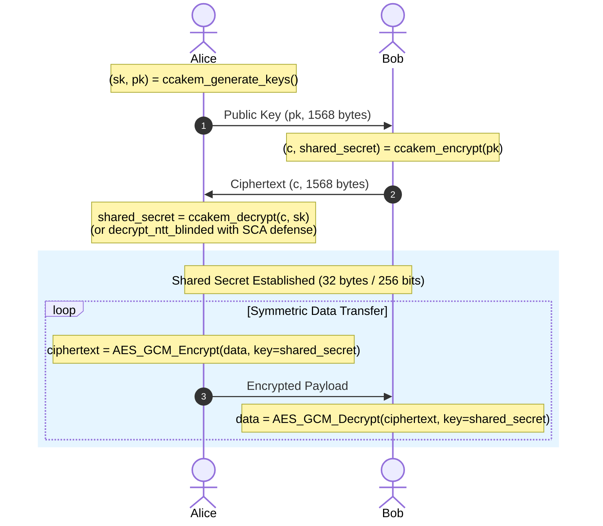

# Usage Guide

> **Provenance Notice:**
> The foundational CLI and core KEM workflow of this repository were originally developed by **Pyry L** ([https://github.com/PyryL/kyber](https://github.com/PyryL/kyber)). This guide includes both the original operations and the **extended side-channel evaluation and benchmarking tools** introduced in this version.

---

## Installation

Ensure you have Python $\geq 3.11$ and [Poetry](https://python-poetry.org/) installed. Clone the repository and install dependencies:

```bash
git clone https://github.com/PyryL/kyber.git
cd kyber
poetry install
```

*(Alternatively, you can install the required packages directly via pip: `pip install numpy pycryptodome matplotlib pytest invoke click`)*

---

## Basic Workflow: Post-Quantum Key Exchange

Kyber operates as an IND-CCA2 Key Encapsulation Mechanism (KEM). Below is a sequence diagram illustrating how Alice and Bob establish a shared symmetric key:



---

## Python API Usage

### 1. Standard CCA-KEM API

```python
from kyber.ccakem import ccakem_generate_keys, ccakem_encrypt, ccakem_decrypt

# 1. Alice generates keypair
sk, pk = ccakem_generate_keys()

# 2. Bob encapsulates a shared secret using Alice's public key
ciphertext, shared_secret_bob = ccakem_encrypt(pk)

# 3. Alice decapsulates the shared secret using her secret key
shared_secret_alice = ccakem_decrypt(ciphertext, sk)

# 4. Both parties now share the identical 32-byte key
assert shared_secret_alice == shared_secret_bob
print("Shared secret:", shared_secret_alice.hex())
```

### 2. Hardened Decryption with NTT Domain Blinding

To protect against physical side-channel leakages (DPA and timing attacks) during decapsulation, use the hardened NTT-blinded routine:

```python
from kyber.ccakem import ccakem_generate_keys, ccakem_encrypt
from kyber.encryption.decrypt_ntt_blinded import decrypt_ntt_blinded

# Keygen & Encapsulation
sk, pk = ccakem_generate_keys()
ciphertext, shared_secret = ccakem_encrypt(pk)

# Decapsulation with NTT Domain Blinding defense
cpapke_sk = sk[: 12 * 4 * 256 // 8]  # Extract CPAPKE private key
recovered_secret = decrypt_ntt_blinded(cpapke_sk, ciphertext)
```

---

## Command-Line Interface (CLI)

The CLI tool `cli.py` allows performing key generation, public key extraction, encryption, and decryption from the command line:

### Step 1: Alice generates a private key
```bash
poetry run python cli.py keygen alice_private.txt
```

### Step 2: Alice extracts her public key to send to Bob
```bash
poetry run python cli.py pubkey --output alice_public.txt alice_private.txt
```

### Step 3: Bob encapsulates a shared secret using Alice's public key
```bash
poetry run python cli.py encrypt --key alice_public.txt --secret bob_secret.txt --cipher cipher.txt
```

### Step 4: Alice decapsulates the ciphertext using her private key
```bash
poetry run python cli.py decrypt --key alice_private.txt --output alice_secret.txt cipher.txt
```

Both `bob_secret.txt` and `alice_secret.txt` will contain the identical shared key.

---

## Evaluation & Demonstration Tools

### 1. Full Comparison & Side-Channel Benchmark
Runs the complete 3-step evaluation: (1) Correctness Verification, (2) Timing Benchmark, and (3) Timing & DPA Attack Simulations.

```bash
# Full evaluation with 60 samples
python -X utf8 demo_comparison.py --samples 60

# Fast verification and benchmark only (skips attacks)
python -X utf8 demo_comparison.py --quick
```

### 2. Quick DPA Correlation Test
Evaluates Pearson correlation reduction on simulated power traces:

```bash
python -X utf8 test_dpa_quick.py
```

### 3. Automated Figure Generation for Reports
Generates high-resolution scatter plots (`scatter_ntt_original.png` and `scatter_ntt_blinded.png`) in the `images/` directory:

```bash
python -X utf8 export_figures.py
```

---

## Development & Maintenance Commands

The project uses [Invoke](https://www.pyinvoke.org/) to automate standard development tasks:

```bash
# Run all unit tests
poetry run invoke test

# Run performance and hybrid AES benchmarks
poetry run invoke performance

# Generate HTML code coverage report (htmlcov/index.html)
poetry run invoke coverage-report

# Run code style and static linting
poetry run invoke lint
```
